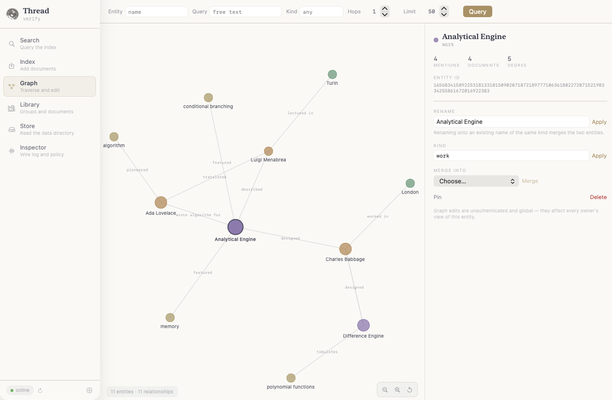

# Thread — the index

[← the stack](../../README.md) · [AII](../AII/README.md) · [Sewn](../Sewn/README.md) · [Seam](../Seam/README.md)

Thread is the index of the Ambient Intelligence Index. It keeps documents as quantized vectors and a
knowledge graph in one store, and answers search with both: the graph decides what is worth scanning,
the vectors rank it, and the graph again brings in neighbours. There is one Thread per Mac, run as
`AIIServer thread` on HTTP 47081 and gRPC 47090, shared by every app. Each app reads and writes its own
**lane**, and the lane comes from the app's secret, never from the request.

Everything runs on device. Embeddings come from `voyage-4-nano` through MLX, and graph extraction
from `Mistral-Nemo` through MLX.

![How Thread answers a search, drawn on one lane. The query "who leads Joltvault?" is embedded by voyage-4-nano. In the lane, the entity Joltvault and the relationship "Ada leads Joltvault" match, gold. Documents linked to them are scanned, blue; the rest are cut by the gate, hollow. Each scanned document gets a distance. One hop from Ada adds a neighbouring document, dashed gold. On the right, the results in ascending distance, cut at top_k, then the hop. Below, a legend of the seven stages and the marks.](../README_Assets/thread-search.png)

## What a lane holds

| | |
| --- | --- |
| **Documents** | an id you choose, a name, a group, a media type (`text`, `code` or `image`), metadata bytes, and partitions: one per text you send, each with a 1024-dimension vector quantized to 16 subvectors. What `AIIInstance` and Sewn file carries an `aii-record/1` envelope as its metadata. |
| **Groups** | an owner's collections (`group_id`, a label, tags, access). Search can be narrowed to some of them. A group lives while it holds documents: the owner's remove or move of its last document drops it, and `removeGroups` deletes one outright. |
| **Entities** | `kind` and `name`, merged across lanes (one device, one graph), each pointing back at its documents. |
| **Relationships** | subject, predicate, object, a weight, and the documents behind them. Each is embedded, so a query can match it by meaning. |

How the graph is built, per document, in this order:
1. **Your entities and relationships**, when the item carries them. Nothing is extracted.
2. **Your tags**, as `concept` entities. Any tag also turns extraction off.
3. **Otherwise, by media type.** For `text`, keyword placeholders come first. Mistral-Nemo then
   extracts entities and relationships on device, after the index call has answered. For `code`,
   `sym:` identifiers come from the source, with no model. For `image`, nothing is extracted.

The extraction policy (`GET`/`PUT /v1/graph/policy`) holds the entity kinds, the prompt, predicate
aliases, the caps (12 entities, 15 relationships), optional co-mention edges and a hub cap. It is
global, applies going forward, and only the stack identity may change it on a shared stack.



## Integrate

Most apps never touch this layer: `AIIInstance` files, recalls and forgets records for them
([AII → Join](../AII/README.md#join)). This section is the wire underneath, for an app that calls
Thread itself over gRPC with the generated `Thread_V1_*` types from `Seam`. Set up the dependency and
the supervisor first ([AII → The long way](../AII/README.md#the-long-way)).

### Connect

```swift
import AII
import Seam
import GRPCCore
import GRPCNIOTransportHTTP2

/// This app's lane of the index. Every call carries the app's secret, so Thread answers in its lane.
struct IndexLane: Sendable {
    let app: AIIApp
    var home: AIIHome = .resolved()

    func call<T: Sendable>(_ body: @Sendable @escaping (GRPCClient<HTTP2ClientTransport.Posix>) async throws -> T) async throws -> T {
        let port = AIIConfig.load(home: home).threadPorts.grpc          // 47090 unless aii/config.json moves it
        let transport = try HTTP2ClientTransport.Posix.http2NIOPosix(
            target: .ipv4(host: "127.0.0.1", port: port), transportSecurity: .plaintext)
        let (home, app) = (home, app)
        let secret = StackSecretClientInterceptor(secret: { try? home.readSecret(for: app) })
        return try await withGRPCClient(transport: transport, interceptors: [secret]) { client in
            try await body(client)
        }
    }
}

let lane = IndexLane(app: "notes")
```

`withGRPCClient` opens a connection per call, which is what Ambient and Craft do. For heavy traffic,
hold one `GRPCClient` and run `client.runConnections()` in a task, as Veil's `ThreadConnection` does.
Wait for `AIIStatus` to report the server `verified` before the first call.

### Deposit

```swift
var item = Thread_V1_ThreadIndexItem()
item.documentID = "notes/2026-10-15-standup"   // yours: stable, unique, and in one lane for life
item.name = "Stand-up, 15 October"
item.texts = paragraphs                         // one partition each: chunk before you send
item.mediaType = "text"                         // "text", "code" or "image"

var request = Thread_V1_ThreadIndexRequest()
request.ownerID = AIIOwner.app("notes").rawValue   // "local-notes"; AIIOwner.local is "aii-local"
request.groupID = "notes-standups"              // start with your app's name: a group is its first owner's
request.groupLabel = "Stand-ups"
request.items = [item]

let indexed = try await lane.call { [request] in
    try await Thread_V1_ThreadQuery.Client(wrapping: $0).index(request).indexedCount
}
```

An owner is a person within your lane. Deposit under the owner you will chat as. With no account,
Sewn answers your app as its lane's owner in the lanes manifest: `local-<app>` (`AIIOwner.app`), or
`aii-local` (`AIIOwner.local`) once the app opts in to the owner Ambient, Craft and Veil share. With an
account, it answers as the user's id (`AIIOwner.account`).
[Protos → Owners](../../Protos/README.md#owners) explains opting in.

To file in the shared record schema with your own client, build the requests from documents.
`AIIDocument.indexRequests(_:owner:)` sets the ids, the group, the metadata, the partitions and the
graph exactly as `AIIInstance` does, one request per group. The schema and how each wire field is filled
are in [Protos → Filing a record](../../Protos/README.md#filing-a-record).

```swift
let documents = try notes.map { try $0.document(app: "notes") }   // each Note is an AIIRecordable
for request in try AIIDocument.indexRequests(documents, owner: .local) {
    _ = try await lane.call { [request] in try await Thread_V1_ThreadQuery.Client(wrapping: $0).index(request) }
}
```

`Index` answers once the vectors are in. Text extraction keeps running after it returns, so the graph
fills in moments later. To bring your own graph instead, which is faster and needs no model, set
`entities` and `relationships` on the item:

```swift
var ada = Thread_V1_ThreadGraphEntityIn();  ada.name = "Ada";        ada.kind = "person"
var jolt = Thread_V1_ThreadGraphEntityIn(); jolt.name = "Joltvault"; jolt.kind = "project"
var leads = Thread_V1_ThreadGraphRelationIn()
leads.subject = "Ada"; leads.predicate = "leads"; leads.object = "Joltvault"
item.entities = [ada, jolt]
item.relationships = [leads]
```

Rules worth knowing:
- **Re-depositing an id replaces it:** its partitions, its metadata and its graph links. Identical
  content changes no link and no count. Filings of one id apply in the order `Index` answered them.
- **An id that already belongs to another lane is refused** with `FAILED_PRECONDITION`, naming the app.
- **A group is its first owner's, in its first lane.** Naming a group another owner or another lane
  holds is refused with `FAILED_PRECONDITION`. Prefix your groups with your app's name.
- **A vector you supply must come from the index's embedder.** One of another size is refused with
  `INVALID_ARGUMENT`.
- **`Index` answers `UNAVAILABLE` while the embedder is still loading.** Retry after a moment.
- **A mismatch refuses indexing.** If the index was built with another embedder, indexing is refused
  and search returns nothing. `AIIStatus.embedder` says which: `matches`, `mismatch` or `unstamped`.

### Search

```swift
var search = Thread_V1_ThreadSearchRequest()
search.queryText = "who leads Joltvault?"       // Thread embeds it
search.ownerID = AIIOwner.app("notes").rawValue   // or AIIOwner.local.rawValue for aii-local
search.topK = 8
// search.groupIds = ["notes-standups"]         // narrow to groups; aggregate = true searches all the owner holds
// search.entities = ["Joltvault"]              // extra names for the graph to match
// search.mediaType = "code"                    // code: identifiers boost, nothing is gated
// search.includeMetadata = true                // each hit's document name, group, metadata and own url

let found = try await lane.call { [search] in try await Thread_V1_ThreadQuery.Client(wrapping: $0).search(search) }
for hit in found.results {                      // ascending: score is a distance, lower is closer
    print(hit.documentID, hit.score, hit.text)
}
print(found.trace.matchedEntityNames, found.trace.expandedDocumentCount)   // what the graph did
```

Each result is one partition: its text, its document, and a product-quantized distance. A document
contributes up to three partitions. With `include_metadata`, each result also carries its document's
`name`, the hit owner's own `group_id` for it, and its `metadata`. It carries the partition's own
`url` too, when its filer gave one, such as a region of a picture. For a record filed by `AIIInstance` or
Sewn, the metadata is its `aii-record/1` envelope, and `AIIRecord.decode(_:)` reads it. The `trace`
explains the graph's part: the entities it matched, the relationship edges it followed, and how many
documents the hop added.

### Walk the graph

```swift
var query = Thread_V1_ThreadGraphQueryRequest()
query.ownerID = AIIOwner.app("notes").rawValue  // or AIIOwner.local.rawValue for aii-local
query.entity = "Joltvault"                      // or query.query = "…" to start by meaning; both empty browses
query.hops = 1
query.limit = 20
query.includeDocuments = true

let graph = try await lane.call { [query] in try await Thread_V1_ThreadGraph.Client(wrapping: $0).query(query) }
for edge in graph.relationships { print(edge.subjectID, edge.predicate, edge.objectID, edge.weight) }
```

### Everything else

| Call | Service | Does |
| --- | --- | --- |
| `remove` | `ThreadQuery` | removes `document_ids`; empty removes everything the owner holds in your lane |
| `library` | `ThreadLibrary` | the owner's groups and their documents, paged with `limit` and `after_id` |
| `documents` | `ThreadLibrary` | the full content of given ids: texts, partitions, metadata, optionally embeddings |
| `exportCorpus` | `ThreadLibrary` | pages through a lane's documents (direct path only) |
| `updateGroup`, `updateDocument` | `ThreadUpdate` | label, description, tags, access; move a document between groups |
| `removeGroups` | `ThreadUpdate` | deletes groups — what is filed in each, then the group, also an empty one; direct path only, never through Sewn |
| `stats` | `ThreadUpdate` | the lane's counts (or `AIIClient(app:).stats()` over HTTP, with top entities) |

### Over HTTP

The same index answers HTTP on 47081, which is handy from a shell or a language without gRPC:

```sh
SECRET=$(cat ~/.rao/secrets/notes)
curl -s localhost:47081/v1/stats -H "X-Ambient-Secret: $SECRET"
curl -s localhost:47081/v1/search -H "X-Ambient-Secret: $SECRET" -H 'Content-Type: application/json' \
     -d '{"query": "who leads Joltvault?", "thread": {"owner_id": "local-notes", "aggregate": true, "top_k": 8}}'
```

HTTP search answers `texts`, `references` (`id`, `partition_id`, `owner_id`) and a `graph` block,
without distances. HTTP ingest (`POST /v1/batch/embeddings`) chunks text when `sanitize` is true. It
derives document ids from the text, so prefer gRPC when you need stable ids.

## How search works

The numbers follow the diagram above. The code is `ThreadQueryServiceImpl.search` and
`PartitionTable.search`.

1. **Lane and candidates.** The secret resolves to a lane, and the candidates are cut to it. Then the
   request picks among them: the owner's documents, given groups, or with `scope: "global"` also the
   documents marked available.
2. **Embed.** `query_text` is embedded with the query role, through a cache.
3. **Match the graph.** Entities match by name against the query text and `entities`. Relationships
   match by embedding, at a dot product of 0.15 or more. Relationships that touch a matched entity
   are kept.
4. **Gate.** Prose only: when a relationship matched, only its documents are scanned. When only an
   entity matched, only the documents that mention it are scanned. When nothing matched, nothing is
   cut. Code is never gated: a matched identifier scales the distance down instead.
5. **Scan.** An asymmetric PQ distance over 16 subvectors, the best three partitions per document, in
   parallel.
6. **Expand.** Prose only: one hop from the matched entities, the relationships' endpoints and the
   hits' own entities. Up to twice `top_k` neighbouring documents, ranked by summed edge weight, each
   adding its best partition at ×1.1 distance.
7. **Rank.** The results are filtered to `media_type` and ordered by ascending distance, then cut at
   `top_k`.

There is no reciprocal-rank fusion and no learned re-ranker. One caveat: entity matching runs over
the whole graph and keeps 8 matches. A word that matches only another lane's entities can therefore
gate your lane down to nothing. When a search comes back empty, try `entities` or rephrase.

## Lanes and provenance

- **The lane comes from the secret.** On the direct path it comes from `x-ambient-secret`. Over
  HTTP it comes from `X-Ambient-Secret`. On Sewn's session it comes from the lane Sewn stamped after
  admitting the app. A `lane` field sent directly is ignored.
- **Any app can have a lane.** An app registers itself (`AIIInstance.join()`, or `aii lanes add`), and
  Thread admits it without a restart. On a secret it doesn't know, Thread reads `secrets/` again, at
  most once every two seconds. It writes the lane of an admitted app that has none into
  `aii/lanes.json`, derived from the device key like every other.
- **The stack identity (`aii`) reads every lane and writes none.**
- **Graph edits follow provenance.** You may rename, merge, delete or re-kind an entity or
  relationship only when every document behind it is in your lane. Otherwise Thread answers 403,
  naming the other app.
- **A document's lane is fixed for life.**

## Reference

| gRPC service (47090) | Methods |
| --- | --- |
| `ThreadQuery` | `Search`, `Index`, `Remove` |
| `ThreadLibrary` | `Library`, `Documents`, `ExportCorpus` |
| `ThreadGraph` | `Query` |
| `ThreadUpdate` | `UpdateGroup`, `UpdateDocument`, `Stats`, `RemoveGroups` (direct only) |

| HTTP (47081) | |
| --- | --- |
| `GET /health` | liveness, the launcher's challenge, and the embedder's state; no secret needed |
| `GET /v1/stats` | the caller's lane: counts and top entities |
| `POST /v1/search` | hybrid search (above) |
| `POST /v1/batch/embeddings` | ingest; 403 for the stack identity, 409 on an embedder mismatch |
| `POST /v1/library`, `/v1/library/document` | groups by owner, groups holding a document |
| `POST /v1/graph` | graph query (`entity` or `query`, `kinds`, `hops` 0–3, `limit`) |
| `POST /v1/graph/entity/{rename,merge,delete,set-kind}`, `/v1/graph/relationship/delete`, `/v1/graph/re-extract` | graph edits, under provenance |
| `GET`/`PUT /v1/graph/policy` | the extraction policy |
| `POST /v1/clear` | `{"confirm": true}` clears your lane; `all` is the stack identity's |

Data lives in `~/.rao/aii/thread/db` as binary plists: `table-<node>`, `graph-<node>`,
`registry-<node>`, `documents/<id>` and `documents/<id>-parts`, `embedder-<node>`, `node-id`,
`graph-extraction-policy`.

Run it alone for development. The supervisor passes the same flags:

```sh
AIIServer thread --port 47081 --grpc-port 47090 --data-dir /tmp/thread --use-mlx
# --mothership-host 127.0.0.1 --mothership-grpc-port 47091   to register with a Sewn
# --no-graph-extraction                                      vectors and your own entities only
```

Without `AII_HOME` the server is open: no secret is asked and there are no lanes. The internals are
covered in [Skills](Skills/SKILLS.md): Database, gRPC, Providers, Persistence, Concurrency and API.
